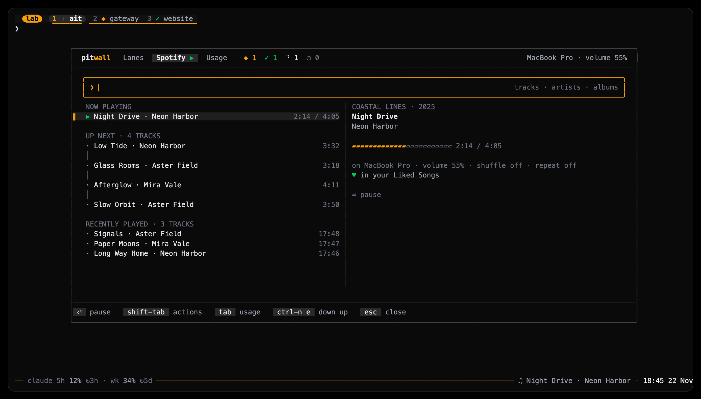

# pitwall-spotify

<p align="center">
  
</p>

<p align="center">
  <a href="LICENSE"></a>
  <a href="https://github.com/mateonunez/pitwall"></a>
  
</p>

Hey! I'm the Spotify plugin for [pitwall](https://github.com/mateonunez/pitwall). While your agents work, I keep what you are listening to one glance away: on tmux's bottom line, and in a view of its own in pitwall's dashboard, where you can pause, skip, save a track or play one you heard earlier, without leaving the terminal.

I talk to Spotify as you, through your own Spotify app. My login tokens stay on your machine, and I stay quiet when nothing plays.

## Install

```sh
pitwall plugin add mateonunez/pitwall-spotify
pitwall spotify login
```

`login` opens the browser. You click *Agree*, and that's it: the tokens renew themselves from then on.

**Your Spotify app, once.** In the [Spotify developer dashboard](https://developer.spotify.com/dashboard), create an app with the *Web API*, and add this redirect URI:

```
http://127.0.0.1:43828/callback
```

Then give me its client ID: in `SPOTIFY_CLIENT_ID`, or in a `.env` beside the plugin. `login` also asks for it if it finds none. The client secret is not needed: the login uses PKCE.

## What you get

**On tmux's bottom line**, beside the machine's numbers in pitwall's tabs layout: `♫ Night Drive · Neon Harbor`, muted while it plays. When you pause, it dims, and it goes after five minutes. It updates when the track should end, or every 30 seconds at most, and only while music plays.

**In the dashboard** (`prefix Space`, then `tab` to *Spotify*):
- what plays, with its album, elapsed time, shuffle and repeat shortcuts, and the next track if one is queued;
- what comes up next;
- what you played recently;
- your owned and followed playlists.

When you reopen the dashboard or a playlist, the last successful view appears while Spotify refreshes it. You can search and move immediately. If Spotify is offline, the hint marks the saved view and the dashboard retries automatically.

On a first open, playlists and tracks become searchable as each page from Spotify arrives. Use Page Up and Page Down to move by a screen of matching results. If you close the popup from Spotify, the next popup on the same tmux server restores the playlist, search and selected row for that login.

Playing a track inside a playlist starts at that track and keeps the playlist as the playback context. Pitwall keeps your filter and selection while the player updates. The player shows the current playlist when it appears in your library.

The timer advances locally each second during playback. Spotify refreshes the position while its tab or a playlist is open. Paused playback and saved snapshots keep their last confirmed position.

The right pane keeps the player above the selected track or playlist. While browsing or filtering, use `ctrl-v` for the previous track, `ctrl-k` to pause or resume, and `ctrl-t` for the next track. Shuffle (`ctrl-z`) and repeat (`ctrl-r`) are available when the device supports them. Enter acts on the highlighted row.

**Find a playlist from the main search.** Open `prefix Space` and type its name or owner, or type `playlist` to list them all. Press Enter to browse. Inside the playlist, type a track, artist or album to narrow the list. Use `ctrl-n` and `ctrl-e` to move and Enter to play the highlighted track. Esc clears the track filter, then takes you back to the playlist you picked. To play the whole playlist, choose *Play playlist* from its actions (`→`, then `p`).

Run `pitwall spotify login` again to approve the expanded permissions. Login requests 19 user scopes for playback, playlists, artwork, follows, listening history, library and profile. Adding `user-personalized` to this grant was rejected with `invalid_scope`. Open Access permissions cover partner integrations. [Spotify scopes](https://developer.spotify.com/documentation/web-api/concepts/scopes)

Spotify allows apps to read the tracks of playlists you own or collaborate on. For other followed playlists, the dashboard offers *Open playlist in Spotify*. [Spotify playlist API](https://developer.spotify.com/documentation/web-api/reference/get-playlists-items)

| Key | On what plays | On a track up next or played recently |
| --- | --- | --- |
| `⏎` | Pause, or play | Play it now |
| `→`, then `]` `[` | Next, previous | |
| `ctrl-z` | Turn shuffle on or off | |
| `ctrl-r` | Cycle repeat through context, track and off | |
| `→`, then `+` `-` | Volume | |
| `ctrl-s` | Save to your Liked Songs (or remove it) | Save it |
| `→`, then `a` | | Add it to the queue (played recently) |
| `→`, then `o` | Open it in Spotify | |

Nothing plays? The view's first line, *Play*, picks up where you left off, on the device you used last or on this computer.

**From the command line**, for you or for an agent:

```sh
pitwall spotify toggle        # play, or pause
pitwall spotify next          # prev goes back
pitwall spotify like          # what plays, into your Liked Songs
pitwall spotify volume 40     # or + and -
pitwall spotify status        # who you are, and what plays where
```

I bind no keys. These are yours to give, in your tmux config:

```tmux
bind m run-shell "pitwall spotify toggle"
bind M run-shell "pitwall spotify next"
```

## Options

| Option | Default | Does |
| --- | --- | --- |
| `@pitwall-spotify-format` | `{title} · {artist}` | What the bottom line says; `{album}` too |
| `@pitwall-spotify-max` | `40` | How long it gets before `…` |
| `@pitwall-spotify-segment` | `on` | `off` keeps it off the bottom line |

Playing, pausing and skipping need Spotify Premium: that is Spotify's rule for its Web API. Without Premium you still see what plays.

## How it is made

This plugin is meant to be read: it is the example of a pitwall plugin from a repo of its own. It is a [manifest](plugin.toml) and [one executable](bin/spotify), Python with nothing but its standard library. pitwall calls it in four ways:

| pitwall calls | When | Here it |
| --- | --- | --- |
| `spotify view` | the dashboard is open | prints the view: heads, rows, actions, the preview of each row |
| `spotify view <playlist-id>` | you enter a playlist | lists its tracks for local search |
| `spotify act <action> <row>` | you pick an action | plays, pauses, skips or saves, then says what happened |
| `spotify cmd …` | `pitwall spotify …` | logs in, controls the player, reports |
| `spotify hook lane.state …` | a lane moves | looks at what plays, if nobody looked for two minutes |

Its piece of the bottom line is a tmux option it sets, `@pitwall_seg_spotify`. pitwall's [plugin contract](https://github.com/mateonunez/pitwall/blob/main/docs/plugins.md) has the rest.

```sh
sh test/run.sh   # against a fake Spotify and a throwaway tmux server
sh test/dashboard.sh ../pitwall   # exercises playback progress and reopening the popup
```

## Privacy

The last player view and the playlists you open are cached under `$XDG_CACHE_HOME/pitwall/spotify` (default `~/.cache/pitwall/spotify`) for your login. Logout clears these views. Showing a snapshot during a refresh requires a pitwall dashboard with the `PITWALL_VIEW_PREVIEW` plugin contract.

The login tokens and your app's client ID live in `~/.config/pitwall/spotify`, readable by you alone. `pitwall spotify logout` deletes them. I call Spotify's API, and only it, and only while you use the view, run a command, or music plays.
